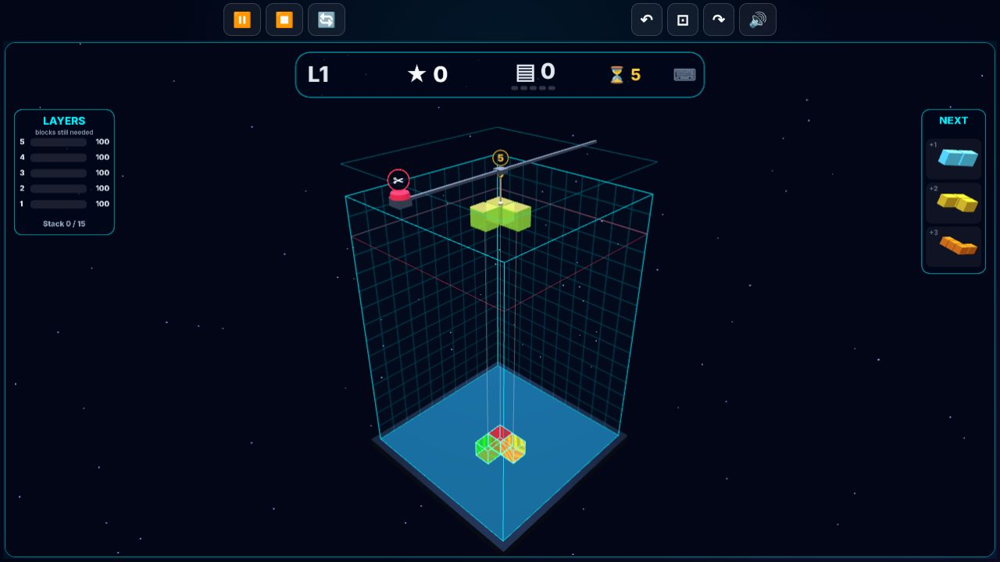

<div align="center">

# 🧊 3D Fortris

**Falling-block puzzle in a true 3D well. Turn pieces on any axis and clear whole layers. Play flat, or in real stereo 3D and VR.**

[](https://srathinagiri.github.io/3D-Fortris/)
[](https://github.com/SRathinaGiri/3D-Fortris)
[](#-3d-and-vr)
[](#-install-as-an-app)
[](https://threejs.org/)
[](LICENSE)

### [▶ Play now in your browser](https://srathinagiri.github.io/3D-Fortris/)



🪔 *Part of the [Diwali Mega Gift Week 2026](https://srathinagiri.github.io/#gift-week): one free app every day, 6–12 November.*

</div>

---

## 🎮 How to play

1. A new piece **hangs from a pulley** at the top of the well for 10 seconds, so you can line it up. Then it falls on its own.
2. **Drag the piece** to slide it across the floor. **Tap it** to see every way it can turn, then tap the one you want.
3. Tap the **✂ cutter** (or press `Space`) to drop it at once.
4. **Fill a whole horizontal layer** to clear it: 100 × level points.
5. 💣 **Bombs** (about 1 piece in 10) blow away the block they land on (+50).
6. Every **5 layers** is a new level: pieces fall faster and points go up.
7. The game ends when a new piece can't appear.

The **NEXT** panel shows the coming three pieces. The **LAYERS** panel shows how many blocks each bottom layer still needs. A rainbow ghost marks where the piece will land.

## ⌨️ Controls

| Action | Touch / mouse | Keyboard | Gamepad |
|---|---|---|---|
| Move the piece | Drag it | Arrow keys | D-pad / left stick |
| Turn the piece | Tap it, pick a turn | `Q` `A` `W` (`E` `D` `S` reverse) | `Y` `X` `B` |
| Drop now | ✂ cutter | `Space` | `A` |
| Turn the camera | Drag empty space | `V` / `Shift+V` | `LB` / `RB` |
| Top view | ⊡ | `T` | — |
| Pause | ⏸ | `P` / `Esc` | `Start` |

Moves are relative to the camera: ↑ always means "away from you".

**Settings (menu):** well size 6–14 cells, height 12 / 15 / 20, touch pad, optional "twin" piece and floor map for easier turning, auto-rotate, high scores. A game in progress is saved, so **Continue** picks it up.

## 👓 3D and VR

- **2D**, **Parallel** and **Cross-eye** side-by-side, **Anaglyph** (red/cyan glasses), and **Smart glasses** half-SBS (RayNeo, XREAL, Rokid, TCL).
- The depth adjusts itself with the camera distance, and the score panels float inside the 3D scene, so they read correctly in every mode.
- **Meta Quest (WebXR):** tap **🥽 VR** in the Quest browser. The well appears about a metre in front of you, its floor below your eyes, so you look down into it.
  - **Play:** the **right stick** moves the piece (left-handed: menu → Controls → 🥽 swaps the hands). Point and pull the **trigger**: drag on the piece to slide it, click it to pick a turn, click the ✂ cutter to drop. **A / X** drops too.
  - **Move the well while you play:** the **other stick** turns the well (left / right) and pushes it away or pulls it closer (forward / back). **Squeeze that hand's grip** to grab the well and carry it with your hand; **squeeze both grips** and pull your hands apart or together to make it bigger or smaller.
  - **Menu:** point at the **☰** beside the score and pull the trigger (or press **B / Y**): ▶ Resume · 📐 Place well (the game waits; both grips and sticks move it; trigger or ✔ when done) · 🎯 Recenter (in front of where you look now) · 🪑 Table / 🏙 Giant presets · ↻ Restart · ⏏ **Exit VR**. Point at a panel button and pull the trigger.
  - Your placement is remembered for next time. The Quest's own Meta button also leaves VR at any time.

## 📲 Phone as controller

Playing on a TV or smart glasses? Menu → Controls → **📲 Phone controller** shows a 6-digit code. Open the link it shows on a phone on the **same Wi-Fi**, enter the code, and use the phone as a joypad: a move stick, a spin pad, and a big ✂ drop button.

Pairing uses the free PeerJS signalling server once to introduce the two devices. After that, button presses go **directly between your devices**.

## 📲 Install as an app

- **Android (Chrome or Edge):** browser menu `⋮` → **Install app**.
- **iPhone / iPad (Safari):** Share → **Add to Home Screen**.
- **Windows / Mac:** click the install icon in the address bar.

Once installed it works fully offline. No account, no ads, no tracking.

---

## 🛠 For developers

<details>
<summary><b>Run, test and release</b></summary>

```bash
python -m http.server 8087     # then open http://localhost:8087
npm test
```

Everything is bundled (three.js r128, PeerJS 1.5.5, synthesised sound), so the game runs offline.

- `tests/logic.test.mjs`: the game rules (spawn, 10 s hold and auto-release, hard drop, orientations, wall kicks, clears, scoring, levels, bombs, game over, camera-relative moves, save/resume) and the high-score storage.
- `tests/version.test.mjs`: the version is in sync everywhere, every module is cached by the service worker and pinned in the import map, icons are installable, and only approved outside hosts are used.

**Releasing:** bump the version in **all** of `js/config.js` (`VERSION`), `sw.js` (`CACHE_VERSION`), `manifest.json`, `index.html` and `controller.html` (badge + `?v=`), and the version badge in this README. The tests fail if any of them disagree.

</details>

<details>
<summary><b>Exact rules</b></summary>

- Floor 10 × 10 by default (6–14 in the menu). Height 12, 15 (default) or 20 ("Classic").
- A new piece waits 10 s, then falls at `max(250, 1200 − 90 × level)` ms per cell.
- Layer clear: 100 × level points. Bomb: +50, about 1 piece in 10 (weight 1.44 against 13 for each other shape).
- New level every 5 cleared layers. A new game always starts at level 1.
- Three pieces are queued.

</details>

<details>
<summary><b>Project structure</b></summary>

```
js/config.js    constants, shapes, speeds (pure)
js/game.js      the rules (pure, unit-tested)
js/progress.js  high scores + saved game (pure)
js/well.js      three.js scene: well, blocks, ghost, effects
js/renderer.js  stereo engine (shared with 3D Labyrinth)
js/hud3d.js     in-scene HUD, NEXT / LAYERS panels, 3D dialogs
js/controls.js  keyboard / gamepad / Quest / orbit input
js/vrrig.js     Quest: where the well stands (move / turn / resize, presets), ☰ menu button, pointing at panels
js/grab.js      in-scene controls: piece drag, pulley + rope + countdown, ✂ cutter, 3D cursor, Quest grab
js/picker.js    orientation picker (every turn of the piece, tap one)
js/twin.js      optional twin piece + floor map
js/audio.js     Web Audio synth
js/ui.js        menu, settings, touch pad
js/link.js      phone pairing (PeerJS)
js/pad.js       controller.html logic
js/app.js       game loop, camera, VR, PWA
```

</details>

Built on the 3D engine of its sister game [3D Labyrinth](https://github.com/SRathinaGiri/3DLabyrinth).

## 📄 License

[MIT](LICENSE) © S. Rathinagiri. three.js and PeerJS are MIT-licensed.
